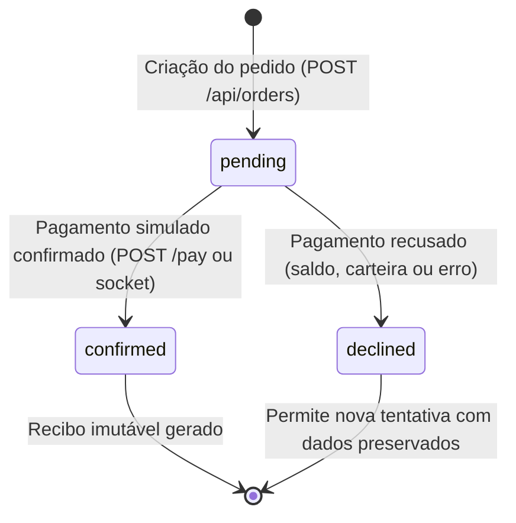

# Arquitetura do NFT Marketplace — Kurio

Este documento detalha as decisões técnicas, padrões arquiteturais, contratos de interface, modelos de persistência, políticas de resiliência e estratégias de validação adotadas na construção do marketplace de NFTs Kurio.

---

## 1. Stack Tecnológica e Responsabilidades

- **React 19 e TypeScript Estrito**: Camada de apresentação tipada com checagem de tipos rigorosa (`strict: true`), garantindo contratos semânticos entre componentes, hooks e a camada de serviços.
- **Vite 8**: Plataforma de compilação, Hot Module Replacement e geração de bundles de produção otimizados.
- **TanStack Router 1**: Roteamento estático, declarativo e tipado em `src/lib/router.ts`. Todas as rotas baseiam-se em arquivos na pasta `src/routes/`, com sincronização bidirecional de search params tipados e validação segura de URLs.
- **TanStack Query 5**: Gerenciador de estado assíncrono para consumo de APIs, particionamento de cache por identidade de usuário, mutações otimistas com rollback e revalidação sob demanda (`src/lib/query-client.ts`).
- **Axios 1**: Cliente HTTP centralizado em `src/lib/http.ts`, configurado com interceptors para injeção de tokens `Bearer`, identificação de visitantes via `X-Guest-Id` e captura de expiração de sessão (HTTP 401).
- **Tailwind CSS v4**: Motor utilitário para design system coeso, paleta escura de alto contraste, tipografia monoespaçada padronizada e responsividade fluida.
- **Mock Service Worker 2 (MSW)**: Camada de interceptação de rede no nível de Service Worker do navegador, provendo contratos REST padronizados e emulação de transporte WebSocket.
- **Socket.IO Client e `@mswjs/socket.io-binding`**: Transporte de eventos em tempo real para sincronização de cotações, disponibilidade e transições de pedidos.
- **Playwright 1**: Suíte abrangente de testes E2E cobrindo fluxos funcionais, resiliência a falhas, acessibilidade por teclado e testes de regressão visual com snapshots comparativos.

---

## 2. Política de Cache, Retries e Reconciliação (TanStack Query)

A instância global do `QueryClient` em `src/lib/query-client.ts` foi configurada para equilibrar fidelidade de dados, performance de rede e experiência de navegação:

```ts
export const queryClient = new QueryClient({
  defaultOptions: {
    queries: {
      staleTime: 30_000,
      gcTime: 5 * 60 * 1000,
      retry: (failureCount, error) => {
        if (axios.isAxiosError(error) && error.response?.status && error.response.status >= 400 && error.response.status < 500) {
          return false
        }
        return failureCount < 2
      },
      refetchOnWindowFocus: false,
    },
  },
})
```

### Decisões de Configuração
- **`staleTime` (30 segundos)**: Consultas do catálogo e detalhes de obras permanecem frescas por 30 segundos, prevenindo requisições desnecessárias durante navegações rápidas entre páginas ou digitação em formulários. Consultas dinâmicas com alta volatilidade (como a cotação do carrinho) utilizam `staleTime` curto ou revalidação explícita.
- **`gcTime` (5 minutos)**: Dados inativos permanecem em memória durante 5 minutos após o desmonte dos componentes associados. Isso possibilita renderização instantânea ao utilizar o histórico do navegador (voltar/avançar), liberando memória de forma controlada após o período.
- **Política Seletiva de Retries**:
  - **Erros de Cliente (HTTP 4xx — 401, 404, 409)**: O retry é abortado imediatamente (`return false`). Falhas de autenticação, recursos inexistentes ou conflitos de concorrência são erros de domínio determinísticos que requerem ação do usuário ou da UI, evitando ciclos de retentativas inúteis.
  - **Falhas Transitórias e de Rede (HTTP 5xx ou timeout)**: Executa até 2 retentativas automáticas antes de propagar o estado de erro, conferindo tolerância a instabilidades momentâneas.
- **Reconciliação e Invalidação sob Demanda**:
  - **Eventos em Tempo Real (Socket.IO)**: Ao receber os eventos `nft.updated` ou `order.updated`, a versão informada é comparada contra a versão mais recente em memória. Sendo estritamente superior, as chaves de consulta relevantes (`['nfts']`, `['cart']`, `['cart', 'quote']`, `['orders']`) são invalidadas, garantindo sincronização sem reload.
  - **Mutações REST**: Inclusões no carrinho, alternância de favoritos ou cadastro de carteiras acionam invalidação focada da chave afetada no callback `onSettled`.
  - **Reconexão de Rede**: Ao recuperar a conexão após desconexão temporária, as consultas ativas são revalidadas para reconciliar eventos ocorridos durante o período offline.

---

## 3. Autenticação, Ciclo de Vida da Sessão e Isolamento de Dados

### Modelo de Sessão
A autenticação não depende de estados voláteis de componente. O estado de login é verificado na inicialização via `GET /api/auth/session`:
- **Armazenamento Seguro de Token**: Somente um token de autorização simulado opaco (`nft_auth_token`) é mantido em `localStorage`. Nenhuma credencial ou senha é exposta no armazenamento.
- **Injeção Transparente**: O interceptor de requisições anexa o cabeçalho `Authorization: Bearer <token>` em todas as chamadas HTTP.
- **Tratamento de Expiração (HTTP 401)**: Quando uma resposta retorna código 401 com aviso de sessão expirada, o interceptor de resposta limpa os tokens locais, remove os dados privados de cache e redireciona o colecionador para a rota `/login?redirect=<url_atual>`, permitindo retorno fluido ao contexto anterior após a autenticação.
- **Isolamento Estrito entre Usuários**: Consultas privadas utilizam a chave composta pelo ID da conta (ex.: `['favorites', user?.id]`, `['orders', user?.id]`, `['wallets', user?.id]`). Ao efetuar logout, o `AuthProvider` executa a remoção completa dessas chaves no cache do `QueryClient` e emite um novo identificador anônimo (`X-Guest-Id`), eliminando qualquer risco de vazamento de dados entre perfis.

---

## 4. Precisão Monetária em ETH (Aritmética em Wei sem Ponto Flutuante)

Valores monetários de criptoativos não podem sofrer imprecisões decorrentes da representação IEEE 754 de ponto flutuante da linguagem. Em `src/lib/eth-currency.ts`:
- **Unidade Base**: Todos os cálculos financeiros são processados em Wei como inteiros exatos (`bigint`), utilizando o fator de escala de $10^{18}$.
- **Conversão e Normalização**: `parseEthToWei(ethString)` converte strings decimais de entrada diretamente para `bigint`.
- **Operações Aritméticas Exatas**:
  - Multiplicação de preço por quantidade: calcula `(precoEmWei * BigInt(quantidade))` e formata o resultado sem arredondamento errôneo.
  - Subtotais, taxas de rede (`0.0025 ETH`) e descontos de cupom são somados e subtraídos em Wei.
  - O cálculo de desconto percentual utiliza divisão inteira exata em Wei: `(subtotalWei * BigInt(percentual)) / 100n`.
- **Desacoplamento Visual**: A função `formatEthDisplay` atua exclusivamente na camada de renderização, sem intermediar os cálculos da regra de negócio.

---

## 5. Carrinho de Compras, Cotações e Mesclagem no Login

- **Persistência de Visitantes**: Navegações anônimas recebem um identificador persistente `X-Guest-Id`. O carrinho e o cupom ativo são mantidos no `MockStore`.
- **Cotação Oficial como Fonte Única da Verdade**: A interface jamais calcula o total final ad-hoc. O endpoint `GET /api/cart/quote` computa subtotal, desconto aplicado, taxa de rede, data limite de validade e sinalizadores de conflito (`stock_exceeded`, `priceChanged`).
- **Mesclagem após Login (`POST /api/cart/merge`)**: Ao autenticar ou registrar nova conta:
  1. Os itens do visitante são somados aos itens já existentes na conta.
  2. Caso a soma exceda o estoque disponível da edição, a quantidade é limitada ao teto e sinalizada para o usuário.
  3. Divergências de preço ocorridas entre a adição e a autenticação são identificadas e recalculadas.
  4. Nenhum item é descartado silenciosamente.

---

## 6. Checkout, Idempotência e Confirmação de Pedidos

### Ciclo de Vida do Pedido


- **`pending`**: O pedido foi registrado com cotação validada, aguardando confirmação. O carrinho de compras permanece intacto.
- **`confirmed`**: O pagamento simulado foi processado. Um identificador permanente de transação (`transactionHash`) e timestamp de confirmação são gravados. Apenas os itens e quantidades efetivamente adquiridos são removidos do carrinho.
- **`declined`**: O pagamento foi rejeitado. O motivo detalhado é gravado e o carrinho do comprador permanece integralmente disponível para nova tentativa.

### Garantia de Idempotência
1. **Identificador Persistente**: O cliente gera e mantém em `sessionStorage` uma chave de idempotência (`Idempotency-Key`).
2. **Fingerprint do Pedido**: O backend calcula um hash determinístico do payload (comprador, edições, quantidades e cotação).
3. **Resolução de Conflitos**:
   - Reenvio com a mesma chave e mesmo fingerprint retorna o pedido já existente com status `200 OK` (sem cobrança duplicada).
   - Reenvio com a mesma chave porém com itens ou valores divergentes resulta em **HTTP 409 Conflict**.
   - No caso de timeout de rede após a criação do registro, o cliente repete a chamada com a mesma chave e recupera o pedido confirmado sem duplicar a compra.

### Revalidação Prévia e Consentimento de Cotação
Antes de processar a transação, a cotação é revalidada junto ao estoque e preços vigentes. Se o valor unitário sofrer alteração (por exemplo, via evento em tempo real), a finalização da compra é bloqueada até que o comprador forneça consentimento explícito sobre os novos valores recalculados.

### Imutabilidade do Recibo
O recibo do pedido em `/pedidos/:orderId` armazena um snapshot completo dos itens comprados, seus preços unitários em ETH, subtotal, desconto e taxa no exato instante da confirmação. Alterações posteriores no catálogo, atualizações via WebSocket ou esvaziamento do carrinho não alteram pedidos históricos.

---

## 7. Perfil do Colecionador, Pedidos e Carteiras

- **Edição de Perfil**: Gerenciamento de nome, biografia e foto de perfil com validação de campos, feedback visual acessível e persistência contínua.
- **Troca de Senha Segura**: Exige a validação da senha atual contra o hash seguro simulado, senha nova com no mínimo 6 caracteres e confirmação obrigatória.
- **Histórico de Pedidos**: Listagem paginada e filtrável por status (`todos`, `confirmados`, `pendentes`, `recusados`), com snapshot histórico imutável e atalhos diretos para os recibos.
- **Gerenciamento de Carteiras Simuladas**:
  - Validação estrita de formato de endereço hexadecimal Web3 (`^0x[a-fA-F0-9]{40}$`).
  - Rejeição de endereços duplicados com HTTP 409 Conflict.
  - Garantia de unicidade da carteira principal: ao definir uma nova carteira como principal, a anterior é desmarcada automaticamente.
  - Bloqueio estrito da exclusão da carteira principal: a exclusão só é permitida após a eleição prévia de outra carteira primária.
  - Aviso explícito de ambiente Web3 simulado: a aplicação informa claramente que não interage com chaves privadas reais nem nós RPC da rede Ethereum principal.

---

## 8. Contratos de API Simulados (REST)

### Autenticação e Conta

| Método | Endpoint | Descrição | Resposta de Sucesso | Erros Tratados |
| --- | --- | --- | --- | --- |
| `POST` | `/api/auth/register` | Criação de conta | `201 Created`: `{ user, token }` | `400`: dados inválidos; `409`: e-mail existente |
| `POST` | `/api/auth/login` | Autenticação | `200 OK`: `{ user, token }` | `400`: campos vazios; `401`: credenciais inválidas |
| `GET` | `/api/auth/session` | Validação de sessão | `200 OK`: `{ user }` | `401`: token ausente ou expirado |
| `POST` | `/api/auth/logout` | Encerramento de sessão | `200 OK`: `{ success: true }` | - |
| `GET` | `/api/account` | Dados cadastrais | `200 OK`: `{ user }` | `401`: não autenticado |
| `PATCH` | `/api/account` | Atualização de perfil | `200 OK`: `{ user }` | `400`: dados inválidos; `401`: não autenticado |
| `POST` | `/api/account/password` | Alteração de senha | `200 OK`: `{ success: true }` | `400`: senha curta; `401`: senha atual incorreta |

### Catálogo e Favoritos

| Método | Endpoint | Descrição | Resposta de Sucesso | Erros Tratados |
| --- | --- | --- | --- | --- |
| `GET` | `/api/nfts` | Catálogo com busca e paginação | `200 OK`: `{ items, total, page, pageSize, totalPages }` | `503`: erro transitório configurado |
| `GET` | `/api/nfts/:nftId` | Detalhes completos do NFT | `200 OK`: `Nft` | `404`: obra não encontrada |
| `GET` | `/api/favorites` | IDs favoritados pelo usuário | `200 OK`: `{ items: string[] }` | `401`: não autenticado |
| `POST` | `/api/favorites` | Adição aos favoritos | `200 OK`: `{ success: true, nftId, items }` | `401`: não autenticado; `500`: falha simulada |
| `DELETE` | `/api/favorites/:nftId` | Remoção dos favoritos | `200 OK`: `{ success: true, nftId, items }` | `401`: não autenticado; `500`: falha simulada |

### Carrinho e Cotação

| Método | Endpoint | Descrição | Resposta de Sucesso | Erros Tratados |
| --- | --- | --- | --- | --- |
| `GET` | `/api/cart` | Consulta itens e cupom ativo | `200 OK`: `CartResponse` | - |
| `POST` | `/api/cart/items` | Adiciona edição ao carrinho | `201 Created`: `CartResponse` | `400`: estoque esgotado ou edição inválida |
| `PATCH` | `/api/cart/items/:id` | Altera quantidade de item | `200 OK`: `CartResponse` | `400`: quantidade excede estoque |
| `DELETE` | `/api/cart/items/:id` | Remove item do carrinho | `200 OK`: `CartResponse` | - |
| `DELETE` | `/api/cart` | Esvazia o carrinho | `200 OK`: `CartResponse` | - |
| `GET` | `/api/cart/quote` | Cotação oficial em ETH | `200 OK`: `CartQuote` | `503`: erro transitório simulado |
| `POST` | `/api/cart/coupon` | Aplica cupom de desconto | `200 OK`: `{ coupon: CartCoupon }` | `400`: cupom inválido ou expirado |
| `POST` | `/api/cart/merge` | Consolida carrinho anônimo | `200 OK`: `MergeCartResponse` | `400`: payload inválido |

### Pedidos e Carteiras

| Método | Endpoint | Descrição | Resposta de Sucesso | Erros Tratados |
| --- | --- | --- | --- | --- |
| `GET` | `/api/orders` | Histórico de pedidos do usuário | `200 OK`: `OrdersListResponse` | `401`: não autenticado |
| `POST` | `/api/orders` | Criação idempotente de pedido | `201 Created` / `200 OK`: `Order` | `400`: cotação vencida; `409`: conflito; `503`: timeout |
| `GET` | `/api/orders/:id` | Detalhes e recibo do pedido | `200 OK`: `Order` | `401`: não autorizado; `404`: não encontrado |
| `POST` | `/api/orders/:id/pay` | Execução simulada do pagamento | `200 OK`: `Order` | `400`: pedido finalizado; `401`: não autenticado |
| `GET` | `/api/wallets` | Carteiras vinculadas à conta | `200 OK`: `WalletsResponse` | `401`: não autenticado |
| `POST` | `/api/wallets` | Vincula carteira simulada | `201 Created`: `{ wallet }` | `400`: formato inválido; `409`: duplicada |
| `PATCH` | `/api/wallets/:id/primary` | Define carteira principal | `200 OK`: `{ wallet }` | `401`: não autenticado; `404`: não encontrada |
| `DELETE` | `/api/wallets/:id` | Remove carteira secundária | `200 OK`: `{ success: true }` | `400`: exclusão da principal bloqueada |

---

## 9. Contrato de Eventos em Tempo Real (Socket.IO)

- **Atualização de Obra (`nft.updated`)**:
  ```ts
  type NftUpdatedEvent = {
    nftId: string
    priceEth: string
    available: number
    version: number
  }
  ```
  Disparado na alteração de preço ou estoque. Descarta mensagens cuja `version` seja menor ou igual à já processada pelo cliente.
- **Atualização de Pedido (`order.updated`)**:
  ```ts
  type OrderUpdatedEvent = {
    orderId: string
    status: 'pending' | 'confirmed' | 'declined'
    declineReason?: string
    transactionHash?: string
    version: number
  }
  ```
  Propaga confirmações e recusas em segundo plano para atualização em tempo real de recibos e históricos.

---

## 10. Estratégia de Testes Automatizados e Regressão Visual

A integridade do sistema é garantida por uma suíte com Playwright contendo testes funcionais determinísticos, acessibilidade e regressão visual:

1. **Testes Funcionais e de Negócio**:
   - `e2e/catalog.spec.ts`: Busca com debounce, filtros combinados, paginação consistente e restrições de estoque.
   - `e2e/auth-favorites.spec.ts`: Fluxos de autenticação, mutações otimistas com restauração de snapshot pós-erro e isolamento de contas.
   - `e2e/cart-quote-socket.spec.ts`: Operações no carrinho, cupons percentuais, aritmética exata em Wei e conciliação de eventos em tempo real.
   - `e2e/checkout-order.spec.ts`: Revalidação de preços, fluxo de compra, prevenção de duplo clique e idempotência.
   - `e2e/profile-orders-wallets.spec.ts`: Gerenciamento cadastral, histórico de compras imutável e regras de carteira principal.
   - `e2e/infrastructure.spec.ts`: Comunicação íntegra do Service Worker (MSW) e canal WebSocket.
2. **Acessibilidade por Teclado e Skeletons (`e2e/visual-a11y-skeletons.spec.ts`)**:
   - Navegação sequencial via tecla `Tab` em todos os campos de formulário, controle de foco em campos de busca e validação semântica de formulários.
   - Skeletons com efeito visual shimmer durante carregamentos e mensagens acessíveis via `role="alert"` com botão funcional de nova tentativa.
3. **Regressão Visual Automatizada (`toHaveScreenshot`)**:
   - Cobertura comparativa das telas de **Início**, **Detalhes do NFT**, **Carrinho de Compras** e **Checkout**, executadas nos viewports Desktop (1440x900) e Mobile (390x844).
   - As imagens oficiais de baseline geradas em ambiente controlado encontram-se versionadas no repositório no diretório `e2e/visual-a11y-skeletons.spec.ts-snapshots/`.

---

## 11. Auditoria Google Lighthouse e Indicadores de Qualidade

Resultados obtidos via execução oficial (`npm run lighthouse`) através de 3 medições consecutivas para cálculo de medianas reais sobre o bundle de produção:

| Página / Perfil | Performance | Acessibilidade | Melhores Práticas | SEO | LCP | CLS | TBT |
| :--- | :---: | :---: | :---: | :---: | :---: | :---: | :---: |
| **Início (`/`) — Desktop** | **98** | **95** | **100** | **100** | 1011 ms | 0.000 | 6 ms |
| **Início (`/`) — Mobile** | **78** | **96** | **100** | **100** | 3895 ms | 0.000 | 174 ms |
| **Detalhes NFT — Desktop** | **94** | **97** | **100** | **100** | 1143 ms | 0.109 | 0 ms |
| **Detalhes NFT — Mobile** | **79** | **97** | **100** | **100** | 4039 ms | 0.000 | 150 ms |

### Ambiente de Medição
- **Node.js**: v24.14.0
- **Google Chrome**: 155.0.8059.85
- **Google Lighthouse**: 13.5.0
- **Sistema Operacional**: Windows 11 Home x64

### Justificativa Técnica para Métricas Mobile
A pontuação de Performance no perfil Mobile situa-se na faixa de 78 a 79 em virtude do estrangulamento padrão de CPU de 4x aplicado pelo Lighthouse, combinado com o custo de inicialização do Service Worker do MSW e dos módulos de mock client-side no bundle de demonstração. Em ambiente Desktop, onde não há sobrecarga de throttling artificial de CPU móvel, o LCP atinge a faixa de 1.0s com notas de 98 e 94. Todas as demais metas de Acessibilidade (95-97), Melhores Práticas (100) e SEO (100) foram integralmente superadas em ambos os perfis, com ausência de Cumulative Layout Shift (0.000 a 0.109) e tempos de bloqueio mínimos.

---

## 12. Segurança, Qualidade e Infraestrutura de Deploy

- **Hashing Determinístico de Senhas**: As credenciais dos usuários pré-cadastrados e de novas contas recebem tratamento determinístico de derivação (`mockHashPassword`) antes da persistência local, evitando senhas legíveis em texto plano no storage do navegador.
- **Rigor de Qualidade de Código (ESLint & TypeScript)**: Regras estritas do ESLint para React 19 mantidas sem supressões arbitrárias. Renders síncronos em cascata foram evitados por meio de microtarefas escalonadas (`queueMicrotask`), garantindo compilação com zero avisos.
- **Otimização de SEO e Metadados Estruturados**: O documento base `index.html` inclui metadados descritivos, tags OpenGraph para compartilhamento social, cor de tema escura `#0b0f19` e tipografia otimizada.
- **Resolução de Roteamento SPA em Deploy**: A aplicação conta com configuração de fallback em `vercel.json` (rewrites para Vercel) e `public/_redirects` (regras SPA para Netlify e Cloudflare Pages), assegurando que o acesso direto ou recarga de URLs internas (`/carrinho`, `/checkout`, `/perfil`, `/pedidos/:id`, `/nfts/:id`) opere sem erros 404 em qualquer provedor de hospedagem estática.
