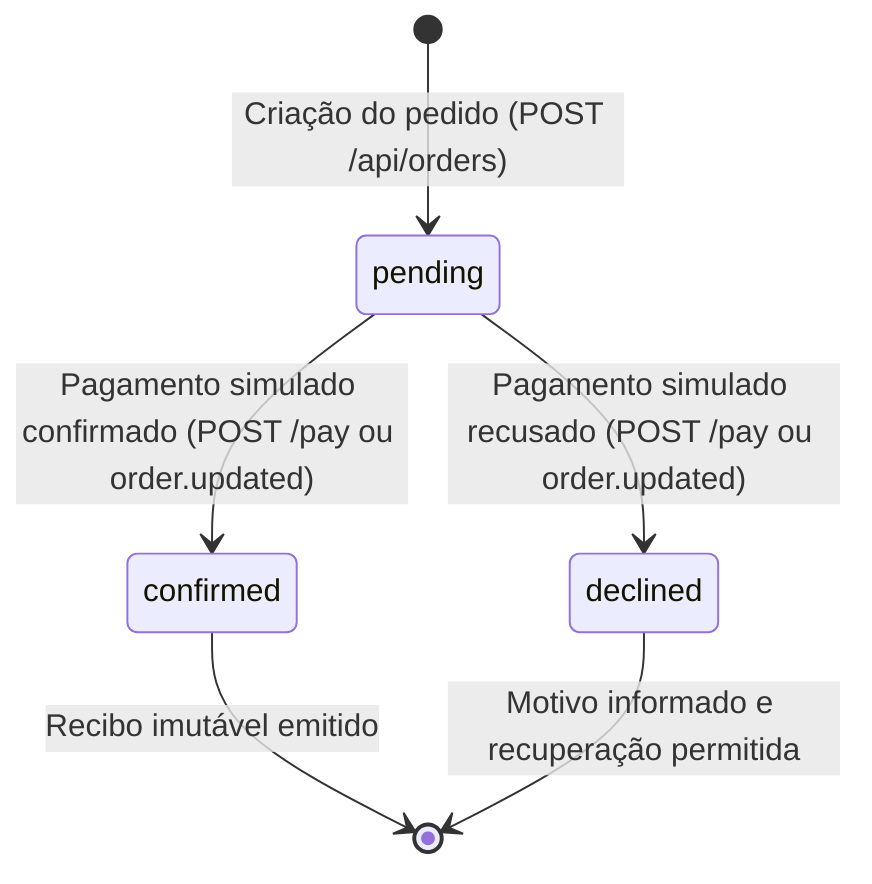

# Arquitetura do NFT Marketplace — GreenMint / Kurio

O `README.md` original do desafio permanece preservado. Este documento detalha a arquitetura, as decisões técnicas, os contratos da API simulada, o gerenciamento de sessão, o isolamento de cache e os testes E2E.

## 1. Stack e responsabilidades

- **React 19 e TypeScript estrito**: interface tipada e contratos rigorosos da camada de apresentação e da API simulada.
- **Vite 8**: servidor de desenvolvimento e build de produção com compilação rápida.
- **TanStack Router 1**: roteamento declarativo e tipado em `src/lib/router.ts`. As rotas são baseadas em arquivos em `src/routes/` e o plugin Vite gera `src/routeTree.gen.ts`.
- **TanStack Query 5**: gerenciamento de estado remoto, cache, mutações otimistas com rollback e isolamento de consultas em `src/lib/query-client.ts`.
- **Axios 1**: cliente HTTP compartilhado em `src/lib/http.ts`, configurado com interceptors para injeção automática de tokens e tratamento de expiração de sessão.
- **Tailwind CSS v4**: estilos atômicos e tokens transcritos da especificação visual.
- **shadcn/ui**: primitivos acessíveis e componentes base.
- **MSW 2 (Mock Service Worker)**: interceptação em nível de rede no navegador para HTTP REST e eventos Socket.IO.
- **Playwright 1**: suíte de testes E2E cobrindo fluxos felizes, cenários determinísticos de erro e responsividade em múltiplos viewports.

## 2. Inicialização e comandos

```sh
npm install
npm run dev
```

- `npm run dev`: inicia a aplicação em modo desenvolvimento com MSW ativado automaticamente.
- `npm run build:demo`: compila a aplicação com mocks habilitados para demonstração e testes E2E.
- `npm run test:e2e`: executa a compilação de demonstração, inicializa o preview e roda a suíte Playwright completa (39 testes determinísticos).
- `npm run typecheck`: validação estrita de tipos TypeScript sem emitir arquivos.
- `npm run lint`: verificação de estilo e boas práticas com ESLint.

## 3. Autenticação e ciclo de vida da sessão

### Gerenciamento de sessão e persistência

A aplicação não considera o usuário autenticado por meras flags em memória. A existência e validade da sessão são confirmadas junto à API mockada por meio de `GET /api/auth/session`:

- **Armazenamento seguro de credenciais**: apenas o token de autenticação simulado opaco (`nft_auth_token`) é mantido em `localStorage`. Nenhuma senha é armazenada em texto claro no navegador.
- **Injeção do token**: o interceptor de requisição em `src/lib/http.ts` anexa o header `Authorization: Bearer <token>` em todas as chamadas HTTP.
- **Sobrevivência a refresh**: na inicialização ou após recarregar a página, o `AuthProvider` (`src/lib/auth-context.tsx`) executa a consulta `['auth', 'session']`. Caso o token seja válido, o usuário é restaurado; se for inválido ou ausente, a sessão é encerrada.
- **Expiração de sessão**: caso qualquer requisição retorne `HTTP 401` com `{ message: 'Sessão expirada.' }`, o interceptor de resposta dispara um evento customizado que limpa o token, remove o cache privado e redireciona o usuário para `/login?redirect=<url_atual>`, preservando o contexto para retorno pós-login.
- **Logout e troca de usuário**: o encerramento da sessão executa `POST /api/auth/logout`, remove o token do armazenamento local e invalida seletivamente as consultas privadas via `queryClient.removeQueries({ queryKey: ['favorites'] })`, `queryClient.removeQueries({ queryKey: ['cart'] })` e `queryClient.removeQueries({ queryKey: ['cart', 'quote'] })`, redefinindo o visitante e gerando um novo `X-Guest-Id` para evitar qualquer vazamento entre contas.

### Contas de demonstração pré-configuradas

- `ana@exemplo.com` / `Password123!` (Nome: Ana Silva, favoritos iniciais: `['nft-aurora-017']`)
- `lucas@exemplo.com` / `Password123!` (Nome: Lucas Costa, favoritos iniciais: `['nft-flora-006']`)

## 4. Favoritos integrados à API e política de cache

A gestão de favoritos foi desacoplada de estados voláteis de componente e integrada diretamente ao backend simulado:

- **Isolamento por identidade**: a query key utilizada é `['favorites', user?.id]`. Como a chave inclui o identificador único do usuário ativo, contas distintas possuem partições de cache estritamente separadas.
- **Mutação otimista com rollback**:
  1. No disparo de inclusão ou remoção (`useFavorites`), o `onMutate` cancela consultas em andamento para a chave do usuário e grava um snapshot do estado anterior.
  2. A interface é atualizada imediatamente no cache local para sensação de resposta instantânea.
  3. Caso a API retorne erro (ex.: falha 500 simulada), o `onError` restaura o snapshot anterior, impedindo que a interface permaneça em estado inconsistente, e expõe mensagem acessível de alerta.
  4. O `onSettled` revalida a consulta para garantir sincronia final com o mock store.
- **Prevenção de concorrência**: cliques repetidos no mesmo item durante uma mutação pendente são ignorados até a conclusão da operação.
- **Usuários não autenticados**: tentativas de favoritar uma obra sem login ativo redirecionam automaticamente para `/login?redirect=<origem>`.

## 5. Etapa 4 — Carrinho de compras, cotações e Socket.IO

### Precisão monetária em ETH (sem ponto flutuante)

Conforme os requisitos da especificação, cálculos financeiros em ETH nunca utilizam `number`, `parseFloat` ou operadores de ponto flutuante da linguagem. Em `src/lib/eth-currency.ts`:
- **Unidade base**: Wei como `bigint` exato (fator de escala $10^{18}$).
- **Conversão e parsing**: `parseEthToWei(ethString)` converte strings decimais puras (ex.: `"1.275"`, `"0.0025"`) em `bigint` sem aproximação numérica.
- **Operações exatas**:
  - `multiplyEth(unitPrice, quantity)`: multiplica o preço unitário em Wei pelo inteiro da quantidade e normaliza para string decimal formatada.
  - `addEth(a, b)` e `subtractEth(a, b)`: somas e subtrações exatas em Wei.
  - `calculateDiscountEth(subtotal, discountPercent)`: cálculo de porcentagem via `(subtotalWei * BigInt(discountPercent)) / 100n`.
  - `compareEth(a, b)`: comparações sem perda de dígitos.
- **Desacoplamento visual**: a função `formatEthDisplay` é estritamente utilitária para apresentação gráfica na interface, sem alimentar cálculos subsequentes.

### Modelo do carrinho e persistência consistente

- **Identidade da sessão e visitante**:
  - Visitantes recebem um identificador persistido `X-Guest-Id` gerenciado por `src/lib/http.ts` (`nft_guest_cart_id`).
  - Usuários autenticados têm seu carrinho identificado pelo seu `user.id`.
  - Toda mutação no carrinho (`addToCart`, `updateCartItemQuantity`, `removeFromCart`, `clearCart`, `applyCoupon`, `removeCoupon`) passa pelo MSW e grava o estado no `MockStore` (`localStorage`).
  - Atualizações de página (`reload`) preservam os itens do carrinho e restabelecem a cotação oficial.

### Regra de mesclagem (Merge) após login

Ao realizar login ou cadastro a partir de uma navegação de visitante:
1. `AuthProvider` invoca `POST /api/cart/merge` passando o `guestId` anterior.
2. Itens comuns entre o visitante e a conta são consolidados (somando quantidades).
3. **Limite de disponibilidade**: se a soma das quantidades ultrapassar o estoque da edição aberta/selecionada, a quantidade final é delimitada (`clamp`) ao máximo disponível, registrando conflito do tipo `stock_exceeded`.
4. **Conflito de preço**: caso o preço da obra tenha mudado desde que foi adicionada, a cotação atualiza para o novo preço unitário e marca `priceChanged: true`.
5. Nenhum item é descartado silenciosamente.
6. Ao fazer logout ou trocar de usuário, o token e o carrinho anterior são dissociados, gerando um novo `X-Guest-Id` para o próximo visitante.

### Cotação oficial como fonte de verdade

- A API `GET /api/cart/quote` calcula a cotação oficial do pedido, incluindo subtotal, desconto percentual de cupom, taxa de rede (0.0025 ETH), valor total, prazo de validade (`validUntil`), flag `isValid` e lista de `conflicts`.
- Cupons implementados: `PROMO10` (10%), `CRYPTO20` (20%), `KURIO5` (5%) e `EXPIRED50` (rejeitado por expiração).
- A interface exibe a cotação vinda do servidor (`quote`), sem jamais substituir o valor final por cálculos ad-hoc no cliente.
- Em caso de indisponibilidade ou falha transitória da cotação (HTTP 503), a interface exibe feedback acessível com botão de recuperação "Tentar novamente".

### Socket.IO e atualizações em tempo real (`nft.updated`)

- **Transporte**: estende a infraestrutura de WebSocket sob `@mswjs/socket.io-binding` e `socket.io-client`.
- **Contrato do evento `nft.updated`**:
  ```ts
  type NftUpdatedEvent = {
    nftId: string
    priceEth: string
    available: number
    version: number
  }
  ```
- **Versão monotônica**: o `SocketProvider` (`src/lib/socket-context.tsx`) monitora a versão mais recente recebida por obra via `lastVersionsRef`. Eventos com versão menor ou igual à última versão conhecida são descartados.
- **Revalidação de consultas**: ao receber um evento válido, as queries de detalhe (`['nfts', 'detail', id]`), catálogo (`['nfts']`), carrinho (`['cart']`) e cotação (`['cart', 'quote']`) são invalidadas, acionando a revalidação imediata dos valores e da disponibilidade.
- **Reconexão**: ao restabelecer a conexão WebSocket após uma desconexão prévia, as consultas do catálogo e do carrinho são invalidadas para garantir sincronia com alterações ocorridas durante o período offline.
- **Cenário de demonstração integrado**: o cabeçalho do carrinho possui um painel expansível de simulação em tempo real que permite alterar preço e estoque do NFT `Aurora #017` e conferir a reação imediata do subtotal e da cotação.

## 6. Contratos REST e endpoints simulados

### Sessão e autenticação

| Método | Rota | Descrição | Resposta de sucesso | Erros previstos |
| --- | --- | --- | --- | --- |
| `POST` | `/api/auth/register` | Criação de conta | `201 Created`: `{ user, token }` | `400`: dados inválidos; `409`: e-mail já cadastrado |
| `POST` | `/api/auth/login` | Autenticação por credenciais | `200 OK`: `{ user, token }` | `400`: campos vazios; `401`: credenciais inválidas |
| `GET` | `/api/auth/session` | Validação da sessão ativa | `200 OK`: `{ user }` | `401`: token ausente, inválido ou expirado |
| `POST` | `/api/auth/logout` | Encerramento da sessão | `200 OK`: `{ success: true }` | - |
| `GET` | `/api/account` | Dados cadastrais do usuário | `200 OK`: `{ user }` | `401`: sessão inválida ou expirada |

### Catálogo e obras

| Método | Rota | Descrição | Resposta de sucesso | Erros previstos |
| --- | --- | --- | --- | --- |
| `GET` | `/api/nfts` | Listagem com busca, filtros, ordenação e paginação | `200 OK`: `{ items, total, page, pageSize, totalPages }` | `503`: erro transitório configurado por cenário |
| `GET` | `/api/nfts/:nftId` | Detalhes completos do NFT | `200 OK`: `Nft` | `404`: obra não encontrada |

### Favoritos

| Método | Rota | Descrição | Resposta de sucesso | Erros previstos |
| --- | --- | --- | --- | --- |
| `GET` | `/api/favorites` | Lista IDs favoritados pelo usuário autenticado | `200 OK`: `{ items: string[] }` | `401`: não autenticado / sessão expirada |
| `POST` | `/api/favorites` | Adiciona um NFT aos favoritos | `200 OK`: `{ success: true, nftId, items }` | `401`: não autorizado; `500`: falha de mutation |
| `DELETE` | `/api/favorites/:nftId` | Remove um NFT dos favoritos | `200 OK`: `{ success: true, nftId, items }` | `401`: não autorizado; `500`: falha de mutation |

### Carrinho e Cotações (Etapa 4)

| Método | Rota | Descrição | Resposta de sucesso | Erros previstos |
| --- | --- | --- | --- | --- |
| `GET` | `/api/cart` | Consulta os itens do carrinho e cupom ativo | `200 OK`: `CartResponse` | - |
| `POST` | `/api/cart/items` | Adiciona edição de NFT ao carrinho | `201 Created`: `CartResponse` | `400`: obra/edição inválida ou esgotada |
| `PATCH` | `/api/cart/items/:itemId` | Altera a quantidade de um item | `200 OK`: `CartResponse` | `400`: quantidade inválida ou superior ao estoque |
| `DELETE` | `/api/cart/items/:itemId` | Remove um item do carrinho | `200 OK`: `CartResponse` | - |
| `DELETE` | `/api/cart` | Esvazia todos os itens do carrinho | `200 OK`: `CartResponse` | - |
| `GET` | `/api/cart/quote` | Calcula a cotação oficial em ETH | `200 OK`: `CartQuote` | `503`: erro transitório configurado por cenário |
| `POST` | `/api/cart/coupon` | Aplica cupom promocional de desconto | `200 OK`: `{ coupon: CartCoupon }` | `400`: cupom inválido ou expirado |
| `DELETE` | `/api/cart/coupon` | Remove o cupom aplicado | `200 OK`: `CartResponse` | - |
| `POST` | `/api/cart/merge` | Mescla carrinho do visitante com conta autenticada | `200 OK`: `MergeCartResponse` | `400`: payload inválido |
| `POST` | `/api/orders` | Cria pedido de forma idempotente e revalida cotação | `201 Created` / `200 OK`: `Order` | `400`: estoque/cotação inválida; `409`: chave reutilizada com payload divergente; `503`: timeout/indisponível |
| `GET` | `/api/orders/:orderId` | Consulta os dados e o estado persistente do pedido | `200 OK`: `Order` | `401`: não autenticado; `404`: pedido não encontrado |
| `POST` | `/api/orders/:orderId/pay` | Executa ou simula o pagamento do pedido | `200 OK`: `Order` | `400`: pedido já finalizado; `401`: não autenticado |

### Controle determinístico de cenários (MSW)

- `POST /api/_mock/scenarios/reset`: restaura o estado padrão do mock store (usuários padrão, sessões, favoritos, fixtures, carrinhos e pedidos).
- `POST /api/_mock/scenarios/expire-session`: força a próxima validação de sessão a falhar com HTTP 401 (`Sessão expirada.`).
- `POST /api/_mock/scenarios/favorites-fail-once`: induz falha HTTP 500 na próxima operação de favorito.
- `POST /api/_mock/scenarios/nft-list-error-once`: induz falha HTTP 503 na próxima consulta ao catálogo.
- `POST /api/_mock/scenarios/cart-quote-error-once`: induz falha HTTP 503 no próximo cálculo de cotação do carrinho.
- `POST /api/_mock/scenarios/emit-nft-update`: atualiza deterministicamente o preço/estoque de um NFT na fixture e dispara o evento `nft.updated` via Socket.IO para os clientes ativos.
- `POST /api/_mock/scenarios/order-payment-result`: configura a ação ou status determinístico do próximo pagamento (`confirmed`, `declined` ou `pending`).
- `POST /api/_mock/scenarios/order-timeout-after-create`: simula timeout de rede após o pedido já ter sido registrado no `MockStore`.
- `POST /api/_mock/scenarios/create-order-error-once`: induz erro transitório HTTP 503 na criação do próximo pedido.
- `POST /api/_mock/scenarios/emit-order-update`: atualiza o pedido no `MockStore` e emite o evento `order.updated` via Socket.IO aos clientes conectados.

## 7. Telas e componentes implementados

- **`/checkout` e `/pagamento` (Etapa 5)**:
  - Tela completa de checkout com revisão dos itens do carrinho, dados do colecionador (nome e e-mail com preenchimento automático a partir do usuário autenticado).
  - Seleção de carteira simulada (MetaMask, Coinbase Wallet, Rainbow) e rede Web3 (Ethereum Mainnet, Polygon, Arbitrum One), com detecção e aviso visual para redes incompatíveis.
  - Conexão e desconexão simulada de carteira com exibição de endereço truncado seguro (`0x...`).
  - Revalidação mandatória de cotação antes do processamento: detecção de alteração de preço requer consentimento explícito do comprador via botão `accept-new-quote-btn`; indisponibilidade ou falta de estoque bloqueia a confirmação.
  - Resumo de valores com precisão em wei e aritmética exata (`subtotalEth`, `discountEth`, `networkFeeEth`, `totalEth`).
  - Proteção contra duplo clique e geração de `Idempotency-Key` persistente em `sessionStorage` para garantir recuperação idempotente pós-timeout.
  - Feedback acessível com `aria-live` e `role="alert"` para erros de rede, cotações alteradas e recusas de pagamento.
- **`/pedidos/$orderId` (Etapa 5)**:
  - Recibo imutável com snapshot exato dos itens, quantidades, edições e preços contratados no momento da compra.
  - Exibição de identificador do pedido (`ord-...`), data e hora da confirmação, hash simulado de transação (`tx-...`), endereço do comprador e carteira utilizada.
  - Tratamento visual dos estados `confirmed` (sucesso com atalho para catálogo), `pending` (aguardando confirmação com polling e atualização via socket) e `declined` (recusa com motivo detalhado e botão para tentar novamente).
  - Suporte à recarga de página e acesso direto por URL autenticada recuperando o estado na API REST.
- **`/carrinho` (Etapa 4)**:
  - Listagem dos itens com foto, coleção, edição, preço unitário, indicador de preço alterado e avisos de estoque.
  - Controles incrementais de quantidade com desabilitação de limites baseados no estoque da edição.
  - Resumo financeiro com subtotal, desconto discriminado, taxa de rede estimada e total geral com formatação segura em ETH.
  - Dedução do carrinho estritamente vinculada a compras confirmadas (pedidos pendentes ou recusados não esvaziam o carrinho).
- **`/login` e `/cadastro` (Etapa 3)**:
  - Autenticação e cadastro com suporte à preservação de redirecionamento (incluindo retorno ao `/checkout`) e mesclagem de carrinho de visitante.
- **Cabeçalho (`MarketplaceHeader`)**:
  - Badge em tempo real com contador de itens no carrinho (`cart-badge-count`).
  - Navegação desktop e mobile responsiva sem overflow horizontal em 390px, 768px e 1440px.

## 8. Arquitetura de Checkout, Idempotência e Pedidos (Etapa 5)

### Estados do pedido e transições válidas



- **`pending`**: O pedido foi registrado com cotação e itens validados, aguardando confirmação do pagamento. O carrinho do usuário permanece intacto.
- **`confirmed`**: O pagamento simulado foi confirmado. O identificador de transação (`transactionHash`) e a data de confirmação (`confirmedAt`) são gravados de forma permanente. Apenas as quantidades compradas são removidas do carrinho do comprador.
- **`declined`**: A simulação rejeitou o pagamento (ex: saldo insuficiente simulado ou rejeição na carteira). O motivo é gravado em `declineReason` e o carrinho permanece intacto para novas tentativas.

### Idempotência estrita entre Cliente e Servidor

1. **Geração e persistência da chave**:
   - Uma chave no formato `idem-<userId>-<timestamp>-<random>` é gerada e salva no `sessionStorage` do navegador sob `nft_checkout_idempotency_key`.
   - A chave é enviada no cabeçalho HTTP `Idempotency-Key` e no corpo da requisição.
2. **Fingerprint do payload no servidor**:
   - O `MockStore` calcula um hash determinístico do payload contendo: comprador, itens ordenados por edição, total em ETH e cupom aplicado.
   - Se uma requisição chegar com a mesma chave e o mesmo fingerprint, o pedido pré-existente é retornado com status `200 OK` (ou `201 Created` na primeira execução).
   - Se a requisição chegar com a mesma chave porém com itens ou valores divergentes, o servidor recusa com **HTTP 409 Conflict**.
3. **Recuperação após timeout de rede**:
   - No cenário em que o servidor cria o pedido mas a conexão sofre timeout antes da resposta chegar ao navegador, a re-execução com a mesma chave recupera exatamente o pedido criado, sem duplicações.
   - Proteção client-side via estado `isSubmitting` impede cliques múltiplos concorrentes.

### Revalidação mandatória de cotação

- A cotação do carrinho não possui validade indeterminada. Antes de submeter o pedido, a aplicação consulta `GET /api/cart/quote` e o backend revalida os preços vigentes nas fixtures e o estoque restante.
- Se houver alteração de preço, a cotação é marcada como inválida e o checkout exibe o banner de aviso (`quote-change-alert`). O botão de compra permanece desabilitado até que o usuário clique em `Aceitar nova cotação` (`accept-new-quote-btn`).
- Se houver indisponibilidade ou estouro de estoque (`item_unavailable` ou `stock_exceeded`), a compra é completamente bloqueada até a correção dos itens no carrinho.

### Imutabilidade do recibo

- O recibo do pedido armazena um snapshot completo dos itens comprados, seus preços unitários em ETH, subtotal, desconto e taxa no exato instante da confirmação.
- Modificações posteriores nas cotações da API, atualizações via Socket.IO ou esvaziamento do carrinho não afetam os pedidos já emitidos.

### Socket.IO e evento `order.updated`

- O evento `order.updated` transporta `{ orderId, status, declineReason, transactionHash, version }`.
- O cliente mantém controle de versão monotônica (`orderVersionsRef`). Eventos com versão menor ou igual à já processada são descartados.
- Ao receber uma atualização válida, o `SocketContext` notifica os listeners e invalida o cache do TanStack Query para reconciliar os dados pela API REST.

## 9. Cobertura de testes E2E (Playwright)

A suíte Playwright conta com **61 testes determinísticos aprovados**, cobrindo 100% dos requisitos do desafio:

### `e2e/checkout-order.spec.ts` (22 testes da Etapa 5)
1. Abrir o checkout com os dados corretos do carrinho.
2. Validar os campos de comprador obrigatórios.
3. Selecionar carteira e rede simuladas.
4. Impedir a compra com estoque ou cotação inválidos.
5. Detectar mudança de preço e solicitar nova confirmação.
6. Detectar mudança de estoque antes da compra.
7. Revalidar cupom, taxas e total.
8. Concluir uma compra após confirmação explícita da simulação de pagamento.
9. Manter o pedido pendente até a confirmação.
10. Tratar pagamento recusado.
11. Impedir pedidos duplicados por duplo clique.
12. Recuperar o pedido após timeout posterior à criação no servidor.
13. Recuperar o mesmo pedido ao repetir a requisição com a mesma chave e payload.
14. Rejeitar a mesma chave com payload diferente (HTTP 409).
15. Recuperar o estado do pedido após atualizar a página.
16. Receber e aplicar um evento `order.updated` válido.
17. Ignorar eventos duplicados e de versões antigas.
18. Recuperar o estado do pedido após reconexão.
19. Garantir que somente as quantidades confirmadas sejam removidas do carrinho.
20. Verificar que o recibo permanece imutável após alterações no catálogo ou no carrinho.
21. Tratar expiração da sessão durante o checkout e preservar o contexto de retorno.
22. Responsividade: telas de checkout e confirmação sem overflow horizontal em 390px, 768px e 1440px.

### `e2e/cart-quote-socket.spec.ts` (16 testes da Etapa 4)
Cobre listagem, adição, atualização, remoção, persistência, cupons, cálculos em ETH com BigInt e eventos `nft.updated`.

### `e2e/auth-favorites.spec.ts` (13 testes da Etapa 3)
Cobre login, cadastro, logout, expiração de sessão, adição/remoção de favoritos, rollback otimista e isolamento de contas.

### `e2e/catalog.spec.ts` (9 testes das Etapas 1 e 2)
Cobre listagem, filtros, ordenação, busca, paginação, detalhes de obra, disponibilidade de edições e 404 recuperável.

### `e2e/diagnostic.spec.ts` (1 teste de integridade da infraestrutura)
Validação de inicialização integrada do MSW e Socket.IO no navegador.

## 10. Limitações da simulação e próximos passos

- **Limitações da simulação Web3 e Pagamentos**:
  - A conexão de carteira e rede é 100% simulada em memória e persistida localmente; não há injeção de `window.ethereum` nem chamada a nós RPC reais da blockchain Ethereum.
  - A assinatura e o hash de transação (`tx-...`) são gerados deterministicamente para fins de demonstração, sem exigência de chaves privadas reais.
  - O transporte WebSocket opera através do mock MSW integrado; após reconexão de rede (`offline` -> `online`), a aplicação reconcilia o estado do pedido via endpoint REST `GET /api/orders/:orderId`.
- **Próximas etapas recomendadas**:
  - **Etapa 6**: Perfil do colecionador e histórico de pedidos (listagem de pedidos anteriores, galeria de NFTs adquiridos e filtros de transações).
